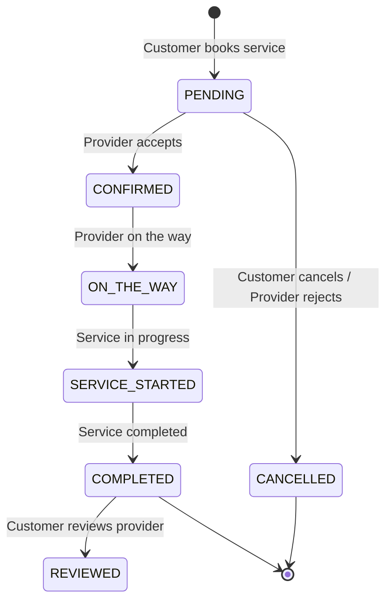

# HandyConnect – Household Services Booking Web Application
### MCA Full-Stack Project: "HandyConnect – An Online Household Services Booking and Management System"

---

## 📌 Project Overview
**HandyConnect** is a modern, full-stack marketplace web application connecting homeowners with verified local household service professionals (plumbers, electricians, cleaners, carpenters, painters, AC technicians, etc.). 

The platform supports 3 distinct user roles with dedicated portals:
1. **👤 Customer**: Search & filter services, schedule appointments, choose convenient time slots, track live job status, pay securely online or COD, and write reviews.
2. **🔧 Service Provider**: Manage professional profile, accept/reject booking requests, manage job lifecycle (*Confirmed → On The Way → In Progress → Completed*), track daily bookings and total earnings.
3. **👨‍💼 Administrator**: System oversight, approve/reject newly registered providers (Verification Desk), manage service categories, inspect global bookings, and review revenue reports.

---

## 🏗️ Architecture & Technology Stack

```
           HANDYCONNECT WEB PLATFORM
                      │
       ┌──────────────┴──────────────┐
       │                             │
   Customer                       Provider
       │                             │
       └──────────────┬──────────────┘
                      │
            React SPA (Vite + Tailwind CSS + Lucide Icons)
                      │  (REST API with Token Authentication)
                      ▼
         Django REST Framework API (Python 3)
      ┌───────────────┼───────────────┐
    Accounts      Bookings        Services
   Providers      Payments        Reviews
      └───────────────┼───────────────┘
                      │
          SQLite / PostgreSQL Database
```

* **Frontend**: React 19, Vite, Tailwind CSS v4, Lucide React Icons, React Router v7, Axios
* **Backend**: Python 3, Django 6.1, Django REST Framework, Django CORS Headers, Token Authentication
* **Database**: SQLite (built-in, zero-setup, immediately portable) / PostgreSQL ready

---

## 🚀 Quick Start Guide

### 1. Backend Setup & Run (Terminal 1)
```powershell
cd backend

# 1. Run migrations (already applied)
python manage.py migrate

# 2. Seed initial data (categories, verified providers, sample bookings)
python seed_data.py

# 3. Start Django development server (runs on port 8000)
python manage.py runserver
```

Backend API will run at: `http://127.0.0.1:8000/`
Django Admin Panel will run at: `http://127.0.0.1:8000/admin/`

---

### 2. Frontend Setup & Run (Terminal 2)
```powershell
cd frontend

# 1. Start Vite development server
npm run dev
```

Frontend will run at: `http://localhost:5173/`

---

## 🔑 Pre-Seeded Demo Accounts (1-Click Login Available)

For viva demonstration and evaluation, the login page contains **1-Click Quick Demo Login** buttons:

| Role | Username | Password | Notes |
| :--- | :--- | :--- | :--- |
| **👨‍💼 Admin** | `admin` | `admin123` | Full admin dashboard & verification desk |
| **👤 Customer** | `upendra` | `customer123` | Active customer with past & upcoming bookings |
| **👤 Customer 2** | `priya` | `customer123` | Alternate customer account |
| **🔧 Provider (Approved)** | `rahul_kumar` | `provider123` | Rahul Kumar (Plumbing pro with 4.8★ rating) |
| **🔧 Provider (Approved)** | `anil_verma` | `provider123` | Anil Verma (Electrician with 4.9★ rating) |
| **🔧 Provider (Pending)** | `manoj_das` | `provider123` | Manoj Das (Waiting for Admin approval) |

---

## 📂 Project Structure

```text
Handy Connect/
├── backend/
│   ├── manage.py
│   ├── seed_data.py              # Realistic sample data populator
│   ├── handyconnect_backend/     # Settings, URL routing, WSGI/ASGI
│   ├── accounts/                 # User model, roles, Auth & JWT/Tokens
│   ├── services/                 # Categories & services catalog
│   ├── providers/                # Provider profiles, availability, verification
│   ├── bookings/                 # Booking workflow, state transitions, stats
│   ├── payments/                 # Multi-method payment processor & receipts
│   └── reviews/                  # Ratings & customer feedback
│
├── frontend/
│   ├── package.json
│   ├── vite.config.js
│   ├── src/
│   │   ├── api/client.js         # Axios API client with token interceptor
│   │   ├── context/AuthContext.jsx # Role-aware authentication context
│   │   ├── components/           # Navbar, Footer, StatusBadge, Modals
│   │   │   ├── BookingModal.jsx  # 6-step interactive booking modal
│   │   │   ├── PaymentModal.jsx  # UPI/QR, Cards, COD checkout & receipts
│   │   │   └── ReviewModal.jsx   # 5-star interactive rating modal
│   │   └── pages/                # Home, Services, Providers, Dashboards
│
└── README.md
```

---

## 🔄 Core Booking Lifecycle Workflow



---

## 🧪 Automated Testing

To run the backend test suite:
```powershell
cd backend
python manage.py test
```
All tests verify role-based access, booking state machines, payment reconciliation, and review integrity.
